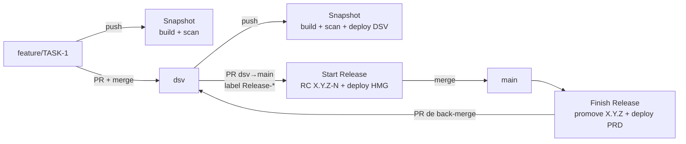

# gitflow-devsecops-pipeline

Template e laboratório de um modelo de esteira corporativa em GitHub Actions:
**workflows centralizados numa camada de plataforma**, repositórios de aplicação
"finos" que só declaram configuração, gates de segurança, versionamento
semântico guiado por label e **promoção do mesmo artefato** de DSV até PRD.

Roda ponta a ponta numa conta pessoal do GitHub, sem nuvem paga: o deploy do
laboratório sobe um cluster `kind` efêmero dentro do runner.



## Por onde começar

| Quero... | Leia |
|---|---|
| entender as duas camadas e por que existem | [01 · Arquitetura](docs/01-arquitetura.md) |
| entender branches, labels, versões e tags | [02 · Gitflow](docs/02-gitflow.md) |
| ver cada pipeline job a job | [03 · Pipelines](docs/03-pipelines.md) |
| entender os arquivos de configuração e onde entra GitOps | [04 · Config as code](docs/04-config-as-code.md) |
| entender os gates de segurança e as exceções | [05 · DevSecOps](docs/05-devsecops.md) |
| rodar o laboratório do zero | [06 · Laboratório](docs/06-laboratorio.md) |
| ver o que o modelo de referência pode melhorar | [07 · Melhorias](docs/07-melhorias.md) |

## Quem é dono de quê

O repositório junta as duas camadas para caber num laboratório. Em produção,
elas são repositórios separados, mantidos por times diferentes
([como separar](docs/01-arquitetura.md#separando-as-camadas)).

| Camada | Arquivos | Dono |
|---|---|---|
| **Aplicação** | `app/`, `pipeline.yml`, `.github/configs/`, `.trivyignore.yaml`, `.github/workflows/{snapshot,start-release,finish-release,redeploy}.yml` | time da aplicação |
| **Plataforma** | `.github/workflows/pipeline-*.yml`, `.github/actions/`, `scripts/`, `templates/` | time de plataforma |

## Validação local

Tudo em Docker, sem instalar nada:

```bash
docker run --rm -v "$PWD:/repo" -w /repo rhysd/actionlint:1.7.4          # workflows
docker run --rm -v "$PWD:/mnt" -w /mnt koalaman/shellcheck:v0.10.0 scripts/*.sh
python3 -m unittest discover -s app -v                                   # testes da app
```
