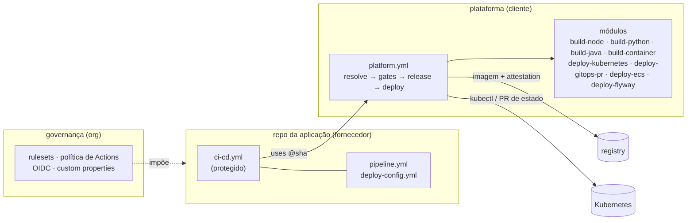

# gitflow-devsecops-pipeline

Template **modular** de esteira em GitHub Actions para organizações que
precisam controlar *como* o código chega à produção, inclusive quando quem
escreve o código são **vários fornecedores**.

- **Um workflow por repositório de aplicação**, que o fornecedor não edita. Toda
  a lógica mora numa camada de plataforma versionada.
- **Fluxo escolhido por configuração**: `gitflow` (integração → PR de release com
  label) ou `trunk` (main + Conventional Commits).
- **Módulos plugáveis**: build por stack (`node`, `python`, `java`, `container`) e
  deploy por driver (`kubernetes`, `gitops-pr`, `ecs`, `flyway`), escolhido por
  artefato.
- **Gates de segurança** (segredos, SAST, SCA, IaC, imagem, DAST) e um contrato
  com **schema**, para que erro de configuração falhe em segundos.
- **Prova de origem**: toda imagem sai com SBOM e attestation assinada, e
  nenhum deploy aceita imagem que não tenha sido construída pela plataforma.
- **Promoção do mesmo digest** de DSV até PRD, sem rebuild.
- **Vários artefatos por repositório**, cada um com seu driver e sua ordem. No
  lab, as migrações do banco (Flyway) rodam antes da API em todo ambiente, e
  migração já publicada não pode ser editada.
- **Configuração por ambiente** em `config/<artefato>/<env>.env` e **segredos só
  por nome**, resolvidos no cofre do cluster: o pipeline nunca vê o valor.
- **Quem aprova cada ambiente, como código** (`envs.<ENV>.reviewers`), e release
  amarrada a um chamado (`flow.changeRef`).
- **Governança como código** para a organização: regras, política de Actions,
  OIDC preso ao workflow, entrada e saída de fornecedor.

Roda ponta a ponta numa conta gratuita: o laboratório faz deploy num cluster
`kind` efêmero e entrega produção por **GitOps** (PR numa branch de estado).



## Por onde começar

| Quero... | Leia |
|---|---|
| entender as camadas e o contrato entre elas | [01 · Arquitetura](docs/01-arquitetura.md) |
| escolher entre gitflow e trunk; versões e tags | [02 · Fluxos](docs/02-fluxos.md) |
| ver o que roda em cada evento, job a job | [03 · Pipelines](docs/03-pipelines.md) |
| configurar uma aplicação (`pipeline.yml`, `deploy-config.yml`) | [04 · Config as code e GitOps](docs/04-config-as-code.md) |
| entender os gates, as attestations e a cadeia de suprimentos | [05 · DevSecOps](docs/05-devsecops.md) |
| rodar o laboratório do zero | [06 · Laboratório](docs/06-laboratorio.md) |
| as lições do modelo de referência | [07 · Melhorias](docs/07-melhorias.md) |
| **controlar vários fornecedores na mesma organização** | [08 · Fornecedores](docs/08-fornecedores.md) |
| criar uma stack, um driver ou um fluxo novo | [09 · Extensão](docs/09-extensao.md) |

## Mapa do repositório

| Camada | Caminho | Dono |
|---|---|---|
| **Aplicação** | `app/`, `pipeline.yml`, `.github/configs/`, `.trivyignore.yaml`, `.github/workflows/{ci-cd,redeploy,housekeeping}.yml` | time da aplicação / fornecedor (os workflows, protegidos) |
| **Plataforma: orquestrador e estágios** | `.github/workflows/platform.yml`, `stage-*.yml`, `ops-*.yml` | time de plataforma |
| **Plataforma: módulos** | `.github/actions/*`, `scripts/`, `templates/`, `schemas/` | time de plataforma |
| **Governança** | `governance/`, `scripts/governance/` | administração da organização |
| **Exemplos** | `examples/` (Node + trunk + GitOps, Java + gitflow + AKS, Python + gitflow + ECS) | — |

## Estado de validação

| Exercitado de ponta a ponta neste repositório | Referência, ainda não exercitado |
|---|---|
| fluxo `gitflow` completo: snapshot → DSV → candidata em HMG → promoção com o mesmo digest → PRD por GitOps → back-merge | fluxo `trunk` (roteamento coberto por teste) |
| recusas em segundos: label, chamado, configuração inválida | driver `ecs`, cluster `aks` e `kubeconfig` |
| attestation no build e **recusa** de imagem sem prova de origem | agente GitOps aplicando a branch de estado (Argo CD/Flux) |
| Flyway (banco efêmero) antes da API; ConfigMap por ambiente | External Secrets num cluster real |
| rollback com a configuração da própria versão | governança de organização (`apply-org.sh` só em simulação) |
| aprovação de PRD, análise de erros classificada, Housekeeping | separação real plataforma × aplicação em dois repositórios |

## Validação local

Em Docker, sem instalar nada:

```bash
scripts/tests/run.sh                                  # 64 testes: versão, roteamento, matriz, manifesto, migrações, classificação de erro
scripts/validate-config.sh .                          # pipeline.yml e deploy-config.yml contra o schema
docker run --rm -v "$PWD:/repo" -w /repo rhysd/actionlint:1.7.12
docker run --rm -v "$PWD:/repo" -w /repo ghcr.io/zizmorcore/zizmor:1.30.1 --offline .github/
```
