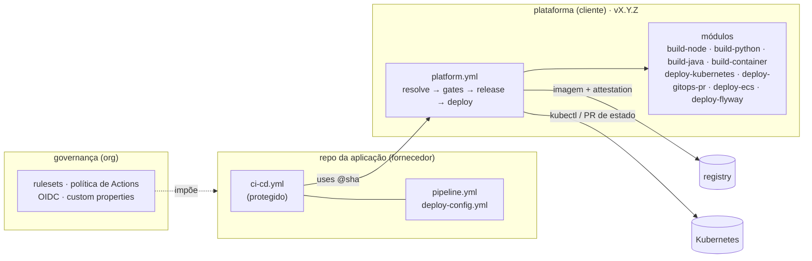

# gitflow-devsecops-pipeline

[](LICENSE)
[](LICENSE-docs)
[](https://github.com/diogorochaaraujo/gitflow-devsecops-pipeline/actions/workflows/platform-ci.yml)

Por **[Diogo Rocha de Araujo](https://github.com/diogorochaaraujo)**, engenharia
de plataforma, DevOps e DevSecOps.

Template **modular** de esteira em GitHub Actions para organizações que
precisam controlar *como* o código chega à produção, inclusive quando quem
escreve o código são **vários fornecedores**. O repositório da aplicação tem
um workflow de poucas linhas, que o fornecedor não edita. Toda a lógica mora
numa plataforma versionada, consumida por SHA.

Roda ponta a ponta numa conta gratuita: deploy num cluster `kind` efêmero e
produção entregue por **GitOps** (PR numa branch de estado).



## O que ele garante

| Tema | Como |
|---|---|
| **Fluxo previsível** | `gitflow` (integração → PR de release com label) ou `trunk` (Conventional Commits), escolhido por configuração. Etapas numeradas **E0–E12**, e cada execução diz em qual está |
| **Erro barato** | schema no contrato e validação do PR (label, chamado, branch em dia, migração imutável): erro de configuração e de processo falha em segundos |
| **Segurança no caminho** | segredos, SAST, SCA, IaC, imagem e DAST, com os mesmos gates no snapshot e na release; exceção só com prazo |
| **Prova de origem** | toda imagem sai com SBOM e attestation; nenhum deploy aceita imagem que a plataforma não construiu; o mesmo digest vai de DSV a PRD |
| **Produção sob controle** | política de promoção (PRD só aceita release publicada), uma aprovação por ambiente, quem disparou não aprova, aprovadores como código |
| **Entrega modular** | build por stack (`node`, `python`, `java`, `container`) e deploy por driver (`kubernetes`, `gitops-pr`, `ecs`, `flyway`), por artefato; banco antes da API |
| **Configuração e segredos** | `config/<artefato>/<env>.env` por ambiente; segredos só por nome, resolvidos no cofre do cluster |
| **Vários fornecedores** | rulesets, política de Actions, OIDC preso ao workflow, entrada e saída de fornecedor por script |
| **Evidência** | `audit.json` por execução (jobs, aprovações, versão da plataforma) e análise de erro classificada, com o que fazer |

## Comece por aqui

| Se você quer... | Leia, nesta ordem |
|---|---|
| **entender o fluxo** | [00 · Mapa do processo](docs/00-mapa-do-processo.md) → [02 · Fluxos](docs/02-fluxos.md) → [01 · Arquitetura](docs/01-arquitetura.md) |
| **rodar o laboratório** | [06 · Laboratório](docs/06-laboratorio.md), consultando [04 · Config as code](docs/04-config-as-code.md) |
| **avaliar a segurança** | [05 · DevSecOps](docs/05-devsecops.md) → [08 · Fornecedores](docs/08-fornecedores.md) |
| **adotar numa organização** | [08 · Fornecedores](docs/08-fornecedores.md) → [10 · Plataforma](docs/10-plataforma.md) → [07 · Lições](docs/07-melhorias.md) |
| **estender** (stack, driver, fluxo) | [09 · Extensão](docs/09-extensao.md), com [03 · Pipelines](docs/03-pipelines.md) como referência |

<details>
<summary>Todos os documentos</summary>

| | Documento | Conteúdo |
|---|---|---|
| 00 | [Mapa do processo](docs/00-mapa-do-processo.md) | o fluxo numa página: etapas, papéis, o que bloqueia, falhou → volte para |
| 01 | [Arquitetura](docs/01-arquitetura.md) | camadas, topologia de ambientes, plataforma × aplicação |
| 02 | [Fluxos](docs/02-fluxos.md) | gitflow, trunk, o que cada evento faz, versões e tags |
| 03 | [Pipelines](docs/03-pipelines.md) | cada job, o deploy por dentro, redeploy, report, housekeeping |
| 04 | [Config as code e GitOps](docs/04-config-as-code.md) | `pipeline.yml`, `deploy-config.yml`, branch de estado |
| 05 | [DevSecOps](docs/05-devsecops.md) | gates, exceções, attestations, cadeia de suprimentos, OIDC |
| 06 | [Laboratório](docs/06-laboratorio.md) | do repositório vazio a PRD, e experimentos que quebram de propósito |
| 07 | [Lições](docs/07-melhorias.md) | padrões de falha de uma esteira corporativa real e a resposta de cada um |
| 08 | [Fornecedores](docs/08-fornecedores.md) | controles por camada, plano do GitHub, acesso, evidência |
| 09 | [Extensão](docs/09-extensao.md) | stack, driver, fluxo, regra de erro ou ferramenta nova |
| 10 | [Plataforma](docs/10-plataforma.md) | como a esteira evolui sem quebrar as aplicações |

</details>

## Mapa do repositório

| Camada | Caminho | Dono |
|---|---|---|
| **Aplicação** | `app/`, `db/`, `config/`, `pipeline.yml`, `.github/configs/`, `.github/workflows/{ci-cd,redeploy,housekeeping}.yml` | time da aplicação / fornecedor (os workflows, protegidos) |
| **Plataforma: orquestrador e estágios** | `.github/workflows/platform.yml`, `stage-*.yml`, `ops-*.yml` | time de plataforma |
| **Plataforma: módulos** | `.github/actions/*`, `scripts/`, `templates/`, `schemas/` | time de plataforma |
| **Governança** | `governance/`, `scripts/governance/` | administração da organização |
| **Exemplos** | `examples/` (Node + trunk + GitOps, Java + gitflow + AKS, Python + gitflow + ECS) | — |

Aqui as duas camadas dividem o repositório, mas já se comportam como
separadas: a aplicação chama a plataforma pela tag `v1.0.0`, **pinada por
SHA**, e não pelo código da própria branch ([10 · Plataforma](docs/10-plataforma.md#neste-repositório)).

## Estado de validação

| Exercitado de ponta a ponta neste repositório | Referência, ainda não exercitado |
|---|---|
| fluxo `gitflow` completo: snapshot → DSV → candidata em HMG → promoção com o mesmo digest → PRD por GitOps → back-merge | fluxo `trunk` (roteamento coberto por teste) |
| recusas em segundos: label, chamado, migração publicada editada | driver `ecs`, cluster `aks` e `kubeconfig` |
| attestation no build e **recusa** de imagem sem prova de origem | agente GitOps aplicando a branch de estado (Argo CD/Flux) |
| política de promoção: snapshot recusado em PRD antes de pedir aprovação | External Secrets num cluster real |
| Flyway (banco efêmero) antes da API; ConfigMap por ambiente | governança de organização (`apply-org.sh` só em simulação) |
| rollback com a configuração da própria versão | plataforma e aplicação em **dois** repositórios |
| plataforma pinada por SHA (`v1.0.0`), com a versão registrada no Audit | aprovação de PRD por uma **segunda pessoa** (*prevent self-review* configurado; até aqui, um aprovador) |
| aprovação de PRD, análise de erros classificada, Housekeeping | |

## Validação local

Tudo em Docker, sem instalar nada, com as mesmas imagens do Platform CI:

```bash
scripts/tests/run.sh               # 82 testes: versão, roteamento, política, matriz, manifesto, migrações, erros
scripts/validate-config.sh .       # pipeline.yml e deploy-config.yml contra o schema
docker run --rm -v "$PWD:/repo" -w /repo rhysd/actionlint:1.7.12
docker run --rm -v "$PWD:/repo" -w /repo ghcr.io/zizmorcore/zizmor:1.30.1 --offline .github/
docker run --rm -v "$PWD:/mnt" -w /mnt koalaman/shellcheck:v0.11.0 scripts/*.sh scripts/governance/*.sh scripts/tests/*.sh
```

Os digests de cada imagem estão em [`platform-ci.yml`](.github/workflows/platform-ci.yml).

## Autoria, licença e como dar crédito

Criado e mantido por **[Diogo Rocha de Araujo](https://github.com/diogorochaaraujo)**.

- **Código** (workflows, actions, scripts, schemas, templates):
  [Apache License 2.0](LICENSE). Pode usar, adaptar e redistribuir, inclusive
  comercialmente, **mantendo o arquivo [`NOTICE`](NOTICE)** com a atribuição.
- **Documentação** (`docs/`, README, diagramas): [CC BY 4.0](LICENSE-docs). Pode
  reutilizar e adaptar **dando o crédito**.

Para dar crédito numa apresentação, documento ou repositório derivado:

> Baseado em [gitflow-devsecops-pipeline](https://github.com/diogorochaaraujo/gitflow-devsecops-pipeline),
> de Diogo Rocha de Araujo, sob Apache-2.0 / CC BY 4.0.

Também dá para usar o botão **"Cite this repository"** do GitHub ([`CITATION.cff`](CITATION.cff)).
Usou ou adaptou? Conte numa *issue*: ver o template em uso em outros cenários é
o que mais ajuda a evoluir ([CONTRIBUTING](CONTRIBUTING.md)).
