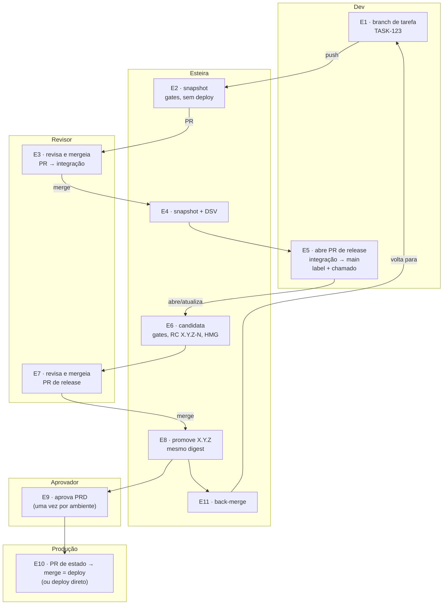
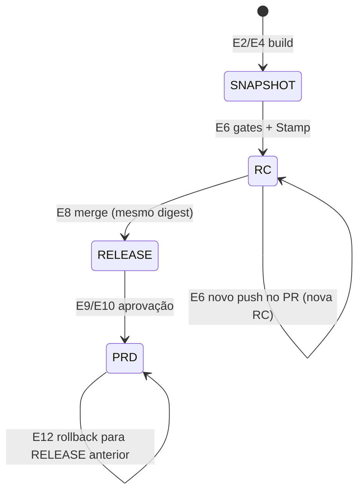

# 00 · Mapa do processo

O fluxo inteiro numa página. Cada etapa tem um número (**E0–E12**), e o resumo de
cada execução do pipeline diz em qual etapa ela está (*Resolve* → `Etapa E6 ·
candidate`). Os demais documentos detalham. Este é o ponto de partida e de
volta.

## Quem participa

| Papel | Faz | Nunca faz |
|---|---|---|
| **Dev** (time interno ou fornecedor) | branch, código, testes, PR, `pipeline.yml`, `deploy-config.yml`, `config/` | alterar workflows, gates ou exceções; aprovar o próprio PR; aprovar HMG/PRD |
| **Revisor** (líder técnico do cliente, via CODEOWNERS) | revisa e aprova PRs para integração e `main` | aprovar o próprio PR |
| **Aprovador** (Environment HMG/PRD) | aprova "a versão X no ambiente Y" | aprovar um deploy que ele mesmo disparou (*prevent self-review*) |
| **Esteira** (plataforma) | valida, constrói, analisa, versiona, entrega, audita | decidir sozinha ir para produção |
| **Agente GitOps** (Argo CD/Flux, quando há) | aplica no cluster o estado mergeado | — |

## O fluxo (modelo `gitflow`)

**E0** (configurar o repositório, uma vez) e **E12** (operar: rollback, aprovações
pendentes, auditoria) ficam fora do ciclo. Detalhe abaixo.

## As etapas

| # | Etapa | Gatilho | Quem age | O que roda | Bloqueia quando | Evidência | Configura em |
|---|---|---|---|---|---|---|---|
| **E0** | preparar o repositório | uma vez | plataforma | `bootstrap-repo.sh` ou `apply-org.sh` | — | rulesets, Environments, labels | [08](08-fornecedores.md), `governance/` |
| **E1** | tarefa | dev cria `TASK-123` a partir da integração | dev | — | — | branch com o nome da tarefa | — |
| **E2** | snapshot da tarefa | push na branch | esteira | Resolve → Security ‖ Build → Gate | config inválida, teste, segurança | imagem `X.Y.Z-N-SNAPSHOT` + attestation, check `Pipeline / Gate` | `pipeline.yml`, `security-config.yml` |
| **E3** | integrar | PR tarefa → integração | revisor | (Gate do E2 é o check) | Gate vermelho, falta revisão | PR revisado | CODEOWNERS |
| **E4** | DSV | push na integração | esteira | E2 + **job DSV**: política → verify → flyway → deploy → smoke → DAST | rollout/smoke, migração | deploy no Environment DSV, relatório DAST | `deploy-config.yml` |
| **E5** | pedir release | PR integração → `main` | dev | Resolve: **branch em dia, um label `Release-*`, chamado, migração imutável** | qualquer uma das quatro, em segundos | — | `pipeline.yml` (`flow`) |
| **E6** | candidata | PR aberto/atualizado/editado/label | esteira | gates completos (sem skip) → **Stamp** `X.Y.Z-N` → **job HMG** | qualquer gate | tag RC, deploy HMG | — |
| **E7** | aprovar a release | — | revisor | ruleset exige Gate verde, code owner, branch em dia, merge commit | qualquer condição do ruleset | PR mergeado | ruleset da `main` |
| **E8** | promover | merge na `main` | esteira | acha a RC do commit → `X.Y.Z` **com o mesmo digest** → tag → GitHub Release | sem RC, versão já publicada, digest divergente | tag `X.Y.Z`, Release | — |
| **E9** | aprovar produção | job PRD esperando | aprovador | **um job por ambiente**: política → verify → flyway → driver | política, attestation, migração | aprovação registrada (Audit) | `envs.PRD.reviewers` |
| **E10** | produção | aprovação | esteira / revisor / agente | `kubernetes`: aplica e confere. `gitops-pr`: PR de estado; **o merge é o deploy** | rollout; revisão do PR de estado | deploy PRD, commit na branch de estado | `deploy-config.yml` |
| **E11** | back-merge | E8 | esteira → revisor | abre PR `main → integração` | — | PR | — |
| **E12** | operar | manual / agenda | qualquer um com permissão | Redeploy (rollback com a configuração da versão), Housekeeping, Audit | política de promoção | issue de pendências, `audit.json` | `redeploy.yml`, `housekeeping.yml` |

## A vida de uma versão

| Versão | Formato | Pode ir para | Recusada em |
|---|---|---|---|
| snapshot | `1.5.0-41-SNAPSHOT` | ambientes de `snapshot` (DSV) | HMG, PRD, ambientes fora do fluxo |
| candidata | `1.5.0-12` (tag) | `snapshot`, `candidate` (HMG), fora do fluxo (TST) | PRD |
| release | `1.5.0` (tag) | qualquer ambiente | — |

A tabela é a **política de promoção**, conferida antes de qualquer aprovação, no
pipeline e no redeploy manual (`scripts/check-deploy-policy.sh`).

## Quando algo falha

Toda falha passa pelo *Report → Error Analysis*, que diz a **classe** e **o que
fazer** (`scripts/error-hints.tsv`). Pela etapa:

| Falhou em | Classe típica | Volta para |
|---|---|---|
| E2/E6 *Resolve* (config) | configuração | corrigir o YAML, novo push |
| E5/E6 *Resolve* (branch, label, chamado, migração) | processo | corrigir o PR (editar título/label reavalia sozinho) |
| E2/E6 Security | segurança | corrigir ou registrar exceção com prazo, novo push |
| E2/E6 Build | build | corrigir o teste ou o build, novo push |
| E4/E6/E10 deploy | deploy | ver logs do job; em cluster persistente o rollback já aconteceu |
| E9 política | processo | promover pela esteira: não existe atalho para produção |
| qualquer, mensagem idêntica em repositórios diferentes | infra/plataforma | não é o código: acionar a plataforma |

## No modelo `trunk`

| gitflow | trunk |
|---|---|
| E2 snapshot da tarefa | **verify** no PR para `main` (build e gates, sem deploy) |
| E3 + E4 integração e DSV | não há integração: DSV entra na lista `candidate` |
| E5–E7 PR de release | o PR da tarefa **é** o PR para `main`; versão pelos commits |
| E8–E10 | iguais, disparados pelo push na `main` |
| E11 back-merge | não existe |

## Onde está cada coisa

| Quero entender | Documento |
|---|---|
| por que duas camadas, plataforma e aplicação | [01 · Arquitetura](01-arquitetura.md) |
| branches, versões, tags | [02 · Fluxos](02-fluxos.md) |
| cada job em detalhe | [03 · Pipelines](03-pipelines.md) |
| os campos de configuração | [04 · Config as code](04-config-as-code.md) |
| gates e cadeia de suprimentos | [05 · DevSecOps](05-devsecops.md) |
| fazer o fluxo inteiro na prática | [06 · Laboratório](06-laboratorio.md) |
| controles para fornecedores | [08 · Fornecedores](08-fornecedores.md) |
| como a própria esteira evolui | [10 · Plataforma](10-plataforma.md) |

---

[índice](../README.md#comece-por-aqui) · [01 · Arquitetura →](01-arquitetura.md)
