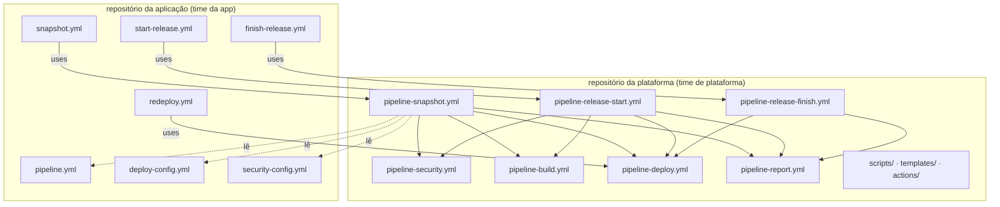
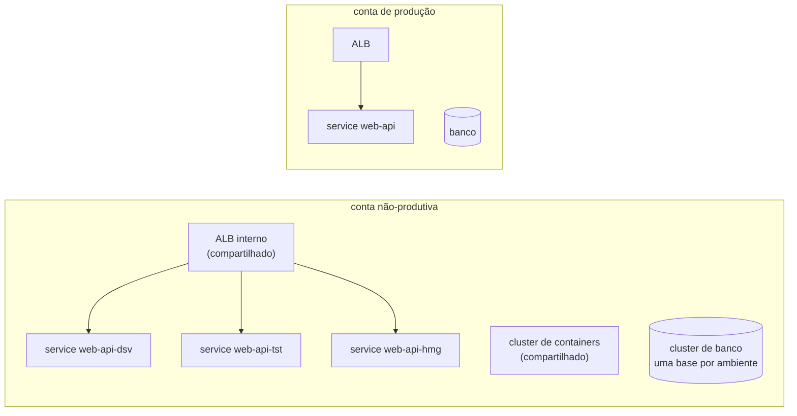

# 01 · Arquitetura

## A ideia central: pipeline como produto

Num ambiente com dezenas ou centenas de repositórios, deixar cada time escrever
a própria esteira produz centenas de esteiras diferentes: gates que uns têm e
outros não, versões de ferramenta divergentes, auditoria impossível. O modelo
documentado aqui inverte isso:

- a **camada de plataforma** é um repositório central de *reusable workflows*
  (`on: workflow_call`), mantido por um time de plataforma. Toda a lógica mora
  nele: build, versionamento, segurança, deploy, auditoria;
- cada **repositório de aplicação** carrega só quatro workflows de ~15 linhas,
  que dizem *quando* rodar e chamam a plataforma, e três arquivos de configuração
  que dizem *o quê* construir e *onde* entregar.



O contrato entre as camadas é **o nome dos arquivos e o formato deles**. O time
da aplicação não edita workflow; edita YAML de configuração. O time de
plataforma muda a esteira de todo mundo num lugar só.

## Como o modelo de referência funciona por dentro

Reconstruído a partir das execuções (nomes de jobs, ordem, tempos e saídas dos
steps), já que o repositório central não é visível a partir dos repositórios de
aplicação.

**Cada job começa igual:** limpa o runner self-hosted, emite um token de GitHub
App de vida curta, faz checkout do código da aplicação *e* checkout dos scripts
da plataforma numa subpasta, e carrega variáveis globais. Os scripts são
PowerShell, organizados como uma action composta por etapa (`prepare-build`,
`prepare-security`, `versioning`, `load-app-info`...).

**Runners self-hosted com ferramentas num volume compartilhado.** JDKs, Node,
Maven, Sonar, scanners e o CLI de IaC ficam num NAS montado em todo runner. Um
catálogo de versões com data de fim de vida bloqueia runtime vencido.

**Três fontes externas alimentam o pipeline em tempo de execução:**

| Fonte | O que entrega | Efeito |
|---|---|---|
| catálogo de aplicações | classificação da app: exposição à Internet, criticidade, dados pessoais, regulatório | decide quais scanners são obrigatórios |
| registro de segurança | cadastro da app nas ferramentas de análise e **exceções com prazo** | sem cadastro, o build para antes de compilar |
| repositório de configs | parâmetros de IaC por área de negócio | alimenta o deploy |

**A esteira também administra o repositório.** No `Prepare Build`, antes de
qualquer coisa, ela sincroniza times e permissões, cria ou atualiza os
Environments (DSV/TST/HMG/PRD) e garante os rulesets: proteção da `main`, tags
imutáveis e bloqueio de alteração em `.github/workflows` e `CODEOWNERS`. O
repositório de aplicação não consegue "desligar" a esteira.

**Artefatos em dois repositórios lógicos.** Snapshots e release candidates vão
para um repositório de artefatos de desenvolvimento. O Finish Release *move* a
RC aprovada para o repositório de release. Nada é reconstruído para produção.

## Topologia de contas e o deploy

O deploy separa **infraestrutura compartilhada** de **aplicação por ambiente**:



- **Uma conta não-produtiva** hospeda DSV, TST e treinamento. Em aplicação só
  interna, hospeda também HMG. Aplicação exposta à Internet tem HMG e PRD em
  contas próprias.
- Na conta compartilhada, **ALB, cluster e cluster de banco são únicos**. Cada
  ambiente ganha *service/task* próprio, base própria dentro do cluster de banco,
  credenciais próprias e parâmetros com sufixo `-<env>` (exceto PRD).
- O ALB roteia **por hostname do ambiente**. Como todas as regras disputam o
  mesmo listener, cada ambiente declara a própria prioridade de regra no
  `deploy-config.yml`. Dois ambientes com a mesma prioridade colidem.
- O nome de cada stack de IaC carrega aplicação, ambiente e artefato:
  `<prefixo>-<tipo>-<app>-<env>-<artefato>-Stack`.

Este template modela isso no `deploy-config.yml` com o mapa `accounts`
(ambiente → grupo de contas). O driver `ecs` assume um papel de deploy diferente
por grupo (`AWS_ROLE_ARN_NPRD`, `AWS_ROLE_ARN_PRD`).

### IaC e deploy são esteiras diferentes

| | IaC da infraestrutura | Deploy da aplicação |
|---|---|---|
| cria | ALB, cluster, banco, filas, buckets | service/task, regra no ALB, parâmetros |
| roda | uma vez por conta (ou por ambiente, para criar usuários de banco) | a cada versão entregue |
| versão | construtos de IaC versionados por major; o pipeline escolhe a faixa compatível | a versão do artefato |

O driver `ecs` deste template assume a infraestrutura criada e só troca a
imagem. O driver `kind` cria tudo a cada execução, porque o cluster morre com o
runner.

## Separando as camadas

1. Crie um repositório `pipeline-platform` com `.github/workflows/pipeline-*.yml`,
   `.github/actions/`, `scripts/` e `templates/`, e publique uma tag (`v1`).
2. No repositório da aplicação, apague esses arquivos e aponte os quatro
   workflows finos para lá:

   ```yaml
   jobs:
     snapshot:
       uses: <org>/pipeline-platform/.github/workflows/pipeline-snapshot.yml@v1
       with:
         platform-repository: <org>/pipeline-platform
         platform-ref: v1
   ```

3. Se o `pipeline-platform` for privado: em *Settings → Actions → General →
   Access*, libere o acesso para os repositórios da organização.

`platform-repository`/`platform-ref` existem porque um reusable workflow não
sabe de onde veio. Os jobs precisam fazer checkout dos scripts da plataforma
explicitamente (o modelo de referência resolve isso com uma action que lê o
`job_workflow_ref`). Dentro da plataforma, `uses: ./.github/workflows/x.yml`
resolve para o mesmo commit do workflow que chama, então os reusables aninhados
continuam funcionando.
