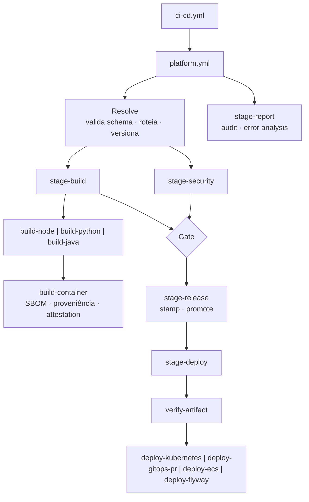
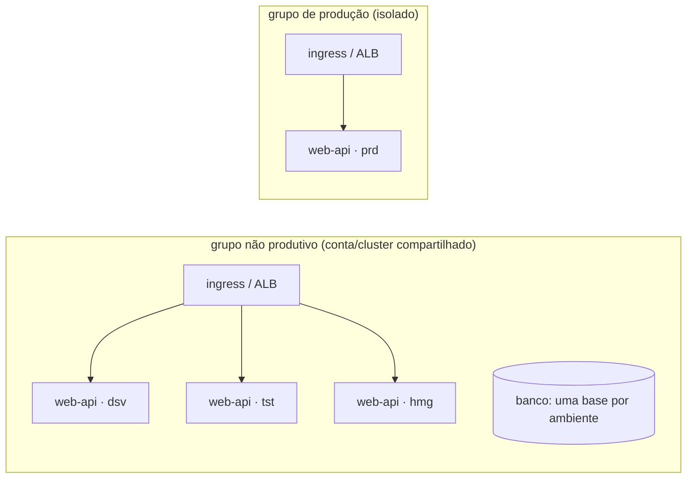

# 01 · Arquitetura

## Pipeline como produto

Quando cada time (ou cada fornecedor) escreve a própria esteira, o resultado são
N esteiras diferentes: gates que uns têm e outros não, versões de ferramenta
divergentes, nenhuma evidência comparável. Aqui a esteira é um **produto da
plataforma**, consumido por configuração:

| Camada | O que é | Muda quando |
|---|---|---|
| **Aplicação** | `ci-cd.yml` (~20 linhas: gatilhos e permissões) + `pipeline.yml` + `deploy-config.yml` | o time da aplicação precisa de algo diferente *dentro do que o contrato permite* |
| **Orquestrador** | `platform.yml`: roteia o evento para os estágios certos | muda o modelo de entrega |
| **Estágios** | `stage-security`, `stage-build`, `stage-release`, `stage-deploy`, `stage-report` (reusable workflows) | muda uma etapa para todo mundo |
| **Módulos** | `build-<stack>`, `build-container`, `verify-artifact`, `deploy-<driver>` (`kubernetes`, `gitops-pr`, `ecs`, `flyway`), como composite actions | entra uma stack ou um alvo de deploy novo |
| **Governança** | rulesets, política de Actions, OIDC, propriedades da org | muda a regra do jogo |



### Por que reusable workflow para estágios e composite action para módulos

| | Reusable workflow (`workflow_call`) | Composite action |
|---|---|---|
| unidade | jobs inteiros, com runner, permissões e `environment` próprios | steps dentro de um job |
| segredos | recebe explicitamente | não acessa `secrets`; recebe por input |
| bom para | etapas com fronteira de permissão (build com `id-token`, deploy com aprovação) | variações de *como* fazer um passo (qual stack, qual driver) |
| limites (GitHub.com, 2026) | 10 níveis de aninhamento, 50 workflows por execução | — |

O build fica num reusable workflow **da plataforma** por um motivo de
segurança: a attestation registra qual workflow construiu a imagem. Com a
plataforma num repositório separado, a aplicação não consegue alterar esse
workflow, o que corresponde ao nível **SLSA Build L3**.

### O contrato

O time da aplicação não escreve YAML de workflow. Ele preenche dois arquivos,
validados contra `schemas/` no primeiro job de toda execução:

- `pipeline.yml`: **o quê** (nome, stack, como testar) e **por qual fluxo**;
- `.github/configs/deploy-config.yml`: **onde** (driver, cluster, grupo de
  contas) e **com que tamanho** (réplicas, CPU, memória) em cada ambiente.

Chave digitada errado, stack inexistente ou driver que não existe falham no
*Resolve*, em segundos, com o campo e a regra violada. Sem o schema, esse tipo
de erro só aparecia no meio do build ou do deploy.

## Topologia de ambientes

O deploy separa **infraestrutura compartilhada** de **aplicação por ambiente**.
É o desenho mais comum em nuvem corporativa:



- ambientes não produtivos dividem conta ou cluster, cada um com seu namespace,
  serviço, base e parâmetros;
- produção é isolada, com credencial e revisores próprios;
- no `deploy-config.yml`, o mapa `accounts` diz o grupo de cada ambiente. Os
  drivers escolhem a credencial pelo grupo (`AWS_ROLE_ARN_<GRUPO>`,
  `AZURE_CLIENT_ID_<GRUPO>`, segredo `KUBECONFIG` do Environment).

### IaC da infraestrutura e deploy da aplicação são esteiras diferentes

| | IaC da infraestrutura | Deploy da aplicação (este template) |
|---|---|---|
| cria | cluster, rede, ingress, banco, filas | Deployment/Service (ou task), configuração do ambiente |
| roda | quando a infraestrutura muda | a cada versão entregue |
| dono | plataforma/infra | plataforma (a aplicação só configura) |

## Separando as camadas

No laboratório tudo está num repositório, e a aplicação já consome a plataforma
pela tag `v1.0.0`, pinada por SHA ([10 · Neste repositório](10-plataforma.md#neste-repositório)).
Numa organização:

1. repositório `pipeline-platform` com `platform.yml`, `stage-*.yml`,
   `ops-*.yml`, `.github/actions/`, `scripts/`, `templates/`, `schemas/`,
   publicado com tags `vX.Y.Z` e *immutable releases*;
2. cada aplicação fica só com `ci-cd.yml`, `redeploy.yml`, `housekeeping.yml` e
   a configuração, chamando a plataforma **por SHA**:

   ```yaml
   jobs:
     pipeline:
       uses: minha-org/pipeline-platform/.github/workflows/platform.yml@<sha> # v2.1.0
   ```

3. o Dependabot propõe a atualização do SHA (com quarentena de 14 dias), e a
   aplicação adota a versão nova por PR.

Um reusable workflow não sabe de onde veio (o contexto `github` é do
chamador), e os jobs precisam dos scripts e actions da plataforma. Por isso
*Resolve* e *Prepare Deploy* leem `referenced_workflows` do próprio run e fazem
checkout da plataforma no SHA do pino. Dentro da plataforma, `uses:
./.github/workflows/x.yml` resolve para o mesmo commit de `platform.yml`, então
os estágios aninhados seguem a versão escolhida. Os inputs `platform-repository`
e `platform-ref` continuam aceitos, só para forçar outra versão.

---

[← 00 · Mapa do processo](00-mapa-do-processo.md) · [índice](../README.md#comece-por-aqui) · [02 · Fluxos →](02-fluxos.md)
