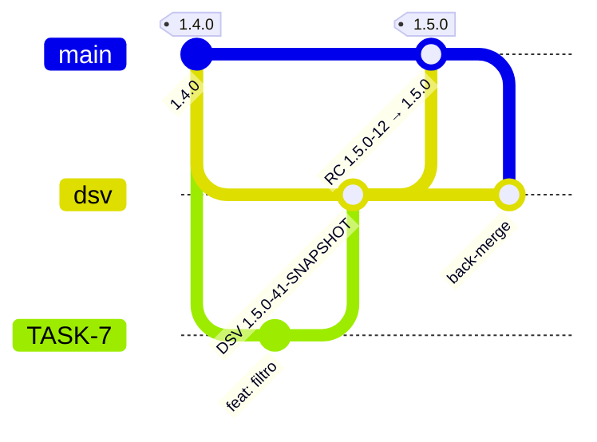
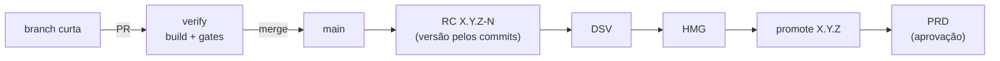

# 02 · Fluxos de entrega

`flow.model` no `pipeline.yml` escolhe o fluxo. A plataforma é a mesma; muda só
o roteamento (`scripts/resolve.sh`).

| | `gitflow` | `trunk` |
|---|---|---|
| branches longas | `main` + integração (`dsv`, `develop`...) | só `main` |
| quem decide a versão | label no PR de release (`Release-Major/Minor/Patch`) | mensagens de commit (Conventional Commits) |
| ponto de controle humano | o PR integração → `main` | o PR para `main` + aprovação de PRD |
| deploy automático | DSV no push da integração; HMG enquanto o PR de release está aberto | `candidate` (ex.: DSV, depois HMG) a cada merge |
| bom para | vários fornecedores entregando no mesmo produto, release com janela | time único, entrega contínua, alta frequência |
| custo | branch longa, back-merge depois de cada release | disciplina de commits; feature flags para o que não está pronto |

## O que cada evento faz

| Evento | `gitflow` | `trunk` |
|---|---|---|
| push em branch de tarefa | **snapshot**: build e gates, sem deploy | nada (o PR verifica) |
| push na integração | **snapshot** + deploy em `snapshot` | — |
| PR para `main` aberto/atualizado/editado/label | **candidate**: gates, RC `X.Y.Z-N`, deploy em `candidate` | **verify**: build e gates, sem deploy |
| push na `main` | nada (o merge do PR promove) | **candidate + promote**: RC, deploy em `candidate`, promoção, deploy em `release` |
| PR para `main` mergeado | **promote**: RC → `X.Y.Z`, deploy em `release`, back-merge | nada (o push faz) |

Push de bot (Dependabot) roda build e gates, mas **não publica nem faz
deploy**: o token desses eventos é só leitura e não tem segredos.

## gitflow

**Duas regras sustentam a promoção sem rebuild:**

1. **A branch do PR não pode estar atrás da `main`.** O *Resolve* recusa
   (`N commit(s) atras de main`), e o ruleset reforça com *require branches to
   be up to date*. Se a branch contém a `main` inteira, o merge produz
   exatamente a árvore que gerou a RC, e por isso a imagem testada em HMG é a
   que vai para PRD.
2. **Depois do merge, a `main` volta para a integração.** O merge commit não
   existe na `dsv`, e o próximo PR de release nasceria atrás da `main`. O job
   *Back-merge* abre esse PR sozinho.

Por isso, o PR de release é mergeado **com merge commit, nunca squash** (o
ruleset só permite `merge`).

**Hotfix:** branch a partir da `main`, PR direto para a `main` com
`Release-Patch`. O back-merge leva a correção para a integração.

## trunk

Versão por [Conventional Commits](https://www.conventionalcommits.org/) desde a
última release:

| Commit | Incremento |
|---|---|
| `feat!: ...` ou rodapé `BREAKING CHANGE:` | major |
| `feat: ...` | minor |
| qualquer outro (`fix:`, `perf:`, `refactor:`...) | patch |

Com vários autores, imponha o formato da mensagem por ruleset (*commit message
pattern*) ou pelo título do PR quando o merge for squash.

## Versões e tags

| Momento | Formato | Onde existe |
|---|---|---|
| snapshot / verify | `<próxima minor>-<run>-SNAPSHOT` | só no registry |
| candidata aprovada nos gates | `X.Y.Z-<run>` | registry + tag git anotada |
| promoção | `X.Y.Z` (mesmo digest da RC) | registry + tag git + GitHub Release |
| versão da plataforma | `vX.Y.Z` | tag git; a aplicação pina o SHA dela ([10](10-plataforma.md#neste-repositório)) |

- as tags são imutáveis por ruleset: uma versão publicada não se move nem se apaga;
- o `-<run>` amarra cada RC à execução que a produziu;
- o `version.sh` só enxerga `^[0-9]+\.[0-9]+\.[0-9]+$`: tags `vX.Y.Z` (da
  plataforma, ou de outro processo) não interferem na versão da aplicação.

---

[← 01 · Arquitetura](01-arquitetura.md) · [índice](../README.md#comece-por-aqui) · [03 · Pipelines →](03-pipelines.md)
