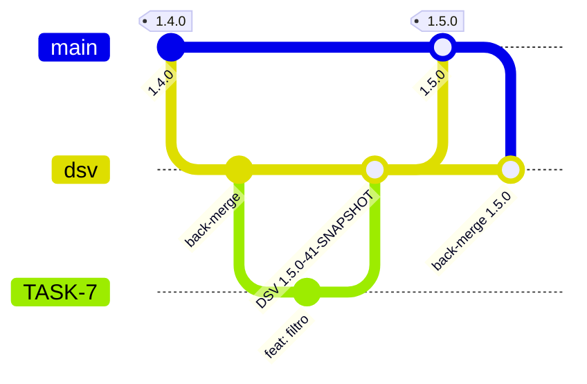

# 02 · Gitflow

## Branches

| Branch | Vida | Papel | Deploy automático |
|---|---|---|---|
| `main` | permanente | linha de produção: cada merge é uma release | PRD (após aprovação) |
| `dsv` | permanente | integração, o `develop` do gitflow clássico | DSV |
| `TASK-123`, `feature/...` | curta | uma tarefa; o nome amarra branch, commits e PR | nenhum (só build e scan) |

A diferença para o gitflow clássico: **não existem `release/*` nem `hotfix/*`**.
A release é o próprio PR `dsv → main`. Enquanto ele está aberto, cada push na
`dsv` gera uma nova release candidate e atualiza o HMG.



### Hotfix

O modelo não tem atalho para a `main`. A correção segue o caminho normal:
branch → `dsv` → PR de release com `Release-Patch`. Se a `dsv` tiver trabalho
que não pode ir junto, há duas saídas, e as duas precisam ser decisão
explícita do time:

- reverter na `dsv` o que não pode ir e reaplicar depois do release;
- PR de uma branch `hotfix/*` criada a partir da `main` direto para a `main`. O
  Start Release aceita qualquer branch de origem, e o back-merge leva a correção
  para a `dsv`.

## Versionamento

SemVer `MAJOR.MINOR.PATCH`, derivado de **tags git**. Não existe arquivo de
versão para editar à mão.

| Momento | Formato | Exemplo | Onde existe |
|---|---|---|---|
| push em qualquer branch | `<próxima minor>-<run>-SNAPSHOT` | `1.5.0-41-SNAPSHOT` | só no registry |
| PR de release aprovado nos gates | `<próxima pelo label>-<run>` | `1.5.0-12` | registry + tag git (release candidate) |
| merge do PR | `X.Y.Z` | `1.5.0` | registry (mesma imagem da RC) + tag git + GitHub Release |

O tipo vem de **exatamente um** label no PR:

| Label | `1.4.2` vira |
|---|---|
| `Release-Major` | `2.0.0` |
| `Release-Minor` | `1.5.0` |
| `Release-Patch` | `1.4.3` |

O `-<run>` é o número da execução do workflow. Ele torna cada RC única e
rastreável até o run que a produziu.

> **Tags com e sem `v`.** O modelo de referência usa `X.Y.Z` sem prefixo para as
> tags da esteira. Se o mesmo repositório recebe tags de outro processo (de
> repasse, de outra ferramenta), use `vX.Y.Z` lá: as duas numerações convivem sem
> disputar espaço, e o `version.sh` só enxerga `^[0-9]+\.[0-9]+\.[0-9]+$`.

## As duas regras que fazem a promoção funcionar

**1. A branch do PR não pode estar atrás da `main`.** O Start Release recusa o PR
se houver qualquer commit na `main` que a branch não tenha:

```
::error::A branch do PR esta 1 commit(s) atras de main.
```

Não é burocracia. Se a branch contém a `main` inteira, a árvore que o merge
produz é **idêntica** à árvore da cabeça do PR, que foi a que gerou a RC. É isso
que permite levar para produção a imagem testada no HMG sem reconstruir. O
ruleset da `main` reforça a mesma coisa com `strict_required_status_checks_policy`
(*"require branches to be up to date"*).

**2. Depois de cada release, a `main` volta para a `dsv`.** O merge do PR cria um
merge commit na `main` que a `dsv` não tem, e o próximo PR de release já nasceria
"1 commit atrás". Por isso o Finish Release abre sozinho o PR de back-merge
`main → dsv`.

Daí também a regra de merge: **PR de release com merge commit, nunca squash.**
Squash reescreve a história e quebra as duas regras.

## Proteções

O que impede atalhos, configurado pelo `scripts/bootstrap-repo.sh`:

| Proteção | Alvo | Efeito |
|---|---|---|
| ruleset `main-protection` | `refs/heads/main` | só por PR; sem force push; sem deleção; check `Start Release / Release Validation` verde; branch atualizada |
| ruleset `tags-imutaveis` | todas as tags | versão publicada não se apaga nem se move |
| Environment `PRD` | deploy | exige aprovação de revisor antes do job de deploy começar |
| `CODEOWNERS` | arquivos da plataforma | PR que toca a esteira precisa do time dono |

O modelo de referência vai além com **rulesets de push**, que recusam no próprio
`git push` qualquer alteração em `.github/workflows/**` e `CODEOWNERS` vinda do
time da aplicação. Esse tipo de regra só existe em organizações com plano pago,
por isso não está no bootstrap.

## Convenção de commits

[Conventional Commits](https://www.conventionalcommits.org/): `tipo(escopo): descrição`,
com o identificador da tarefa no rodapé (`Refs: TASK-123`). O Finish Release
gera as notas da release a partir dos PRs (`gh release create --generate-notes`).
