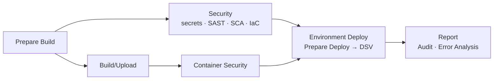
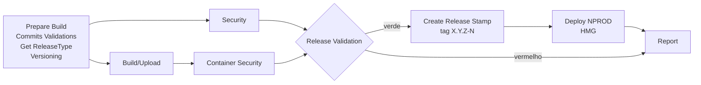
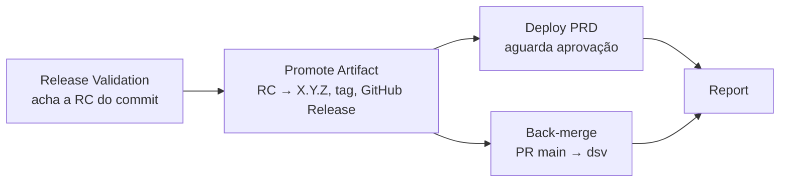

# 03 · Pipelines

Quatro gatilhos, quatro pipelines. Os nomes dos jobs seguem os do modelo de
referência, para facilitar a comparação entre um log e outro.

| Workflow fino | Gatilho | Pipeline | Deploy em |
|---|---|---|---|
| `snapshot.yml` | push em qualquer branch exceto `main` | `pipeline-snapshot.yml` | `SnapshotEnvs`, só para `SnapshotBranches` |
| `start-release.yml` | PR para `main`: aberto, atualizado, label trocado | `pipeline-release-start.yml` | `StartReleaseEnvs` |
| `finish-release.yml` | PR para `main` fechado com merge | `pipeline-release-finish.yml` | `FinishReleaseEnvs` |
| `redeploy.yml` | manual (`workflow_dispatch`) | `pipeline-deploy.yml` | o ambiente escolhido |

## Snapshot

| Job | O que faz | Quebra quando |
|---|---|---|
| Prepare Build | lê `pipeline.yml` e `security-config.yml`, calcula `X.Y.Z-N-SNAPSHOT`, decide se a branch faz deploy | config inválida |
| Security | gitleaks no histórico, semgrep, trivy fs/config, em paralelo | achado acima do gate |
| Build/Upload | testes, `docker build`, push no registry com SBOM e proveniência | teste ou build falha |
| Container Security | trivy na imagem publicada | CVE com correção disponível acima do gate |
| Environment Deploy | só se a branch está em `SnapshotBranches` | rollout não estabiliza ou o `/health` responde outra versão |
| Report | registro de auditoria sempre; análise de erros se algo falhou | nunca |

Toda branch ganha build e análise: o feedback de segurança chega no PR da
tarefa, não depois do merge. Só a branch de integração ocupa o DSV.

## Start Release

| Job | O que faz |
|---|---|
| Prepare Build | `validate-pr.sh`: evento é PR, branch não está atrás da base, exatamente um label `Release-*`. Depois calcula `X.Y.Z-N` |
| Security, Build, Container | iguais ao snapshot, **sem nenhum skip** |
| Release Validation | agrega os resultados: um job não-verde reprova a release. É o **check obrigatório** da `main` |
| Create Release Stamp | cria a tag anotada `X.Y.Z-N` no commit da cabeça do PR. É o "carimbo" que o Finish Release procura |
| Deploy NPROD | entrega a RC nos ambientes de `StartReleaseEnvs` |

Cada push no PR (ou troca de label) reinicia o fluxo e cancela o anterior. As RCs
anteriores ficam como tags, mas só a do commit final será promovida.

## Finish Release

| Job | O que faz |
|---|---|
| Release Validation | procura a tag `X.Y.Z-N` que aponta para o commit da cabeça do PR. Sem ela, o PR foi mergeado sem Start Release verde, e para aqui |
| Promote Artifact | `docker buildx imagetools create`: nova tag `X.Y.Z` para **o mesmo digest** da RC. Cria a tag git `X.Y.Z` no merge commit e a GitHub Release |
| Deploy | `FinishReleaseEnvs`. O Environment `PRD` segura o job até um revisor aprovar |
| Back-merge | abre o PR `main → dsv` (ou avisa que já existe) |

No modelo de referência, este é também o momento da **análise Sonar oficial** e
do **Quality Gate**: a análise roda sobre o código que entrou na `main`.

## Redeploy

Reimplanta uma versão que já existe no registry, sem passar por build:

- `deploy`: volta uma versão (rollback manual) ou reaplica configuração alterada
  no `deploy-config.yml`;
- `diff`: mostra o que mudaria;
- `destroy`: desliga o ambiente.

Como usa o mesmo `pipeline-deploy.yml`, um redeploy em PRD também passa pela
aprovação do Environment.

## O deploy por dentro

`pipeline-deploy.yml` é o único lugar que sabe entregar. Ele recebe ambientes e
versão, e:

1. **Prepare Deploy**: `render-deploy-matrix.sh` cruza `artifacts` × ambientes
   pedidos, aplica o bloco `envs.<ENV>` por cima da base e gera a matriz;
2. **um job por (ambiente, artefato)**, em série (`max-parallel: 1`), cada um com
   `environment: <ENV>` (aprovação, segredos e histórico de deploy por ambiente)
   e `concurrency` por ambiente (dois deploys no mesmo ambiente nunca se cruzam);
3. o **driver** escolhido por `serverType`:

| Driver | Onde | O que faz |
|---|---|---|
| `kind` | cluster efêmero no runner | namespace por ambiente, `kubectl apply`, `rollout status`, smoke test que compara a versão do `/health` com a entregue, DAST com ZAP |
| `ecs` | AWS ECS Fargate | assume o papel do grupo de contas via OIDC, registra nova task definition com a imagem, `update-service`, espera estabilizar (circuit breaker com rollback no serviço) |

## Report: auditoria e análise de erros

Toda execução termina com o job **Audit**, que grava um JSON (pipeline, versão,
commit, autor, evento, resultado de cada etapa) como artefato e resumo do run.
No modelo de referência esse evento vai para um coletor central; aqui fica no
próprio run.

Se algo falhou, **Error Analysis** busca pela API os jobs que quebraram e junta
as linhas `##[error]` de cada um no resumo. É a primeira coisa a ler antes de
abrir log: mensagem idêntica em repositórios de stacks diferentes, ou erro sobre
*cadastro* em vez de *arquivo*, quase sempre é infraestrutura, não código.
