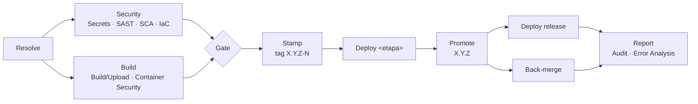

# 03 · Pipelines

Um orquestrador (`platform.yml`), sempre com os mesmos jobs. O *Resolve* decide
quais rodam. Os nomes seguem o que aparece na aba Actions.

## Jobs

| Job | Faz | Falha quando |
|---|---|---|
| **Resolve** | valida `pipeline.yml` e `deploy-config.yml` contra o schema; roteia o evento; no PR de release, confere branch em dia, label e chamado (`changeRef`); recusa migração publicada alterada; calcula a versão | config inválida, branch atrás da base, label ausente ou duplicado, PR sem chamado, migração editada |
| **Security** | gitleaks no histórico, semgrep, trivy (dependências e IaC), em paralelo | achado acima do gate |
| **Build** | módulo da stack (deps com cache, lint, **testes**), imagem com SBOM e proveniência, **attestation** assinada, scan da imagem por digest | teste, build ou CVE acima do gate |
| **Gate** | agrega: verde só se todo estágio exigido nesta execução passou. **É o check obrigatório dos rulesets** (`Pipeline / Gate`) | qualquer estágio exigido falhou |
| **Stamp** | tag anotada `X.Y.Z-N` no commit construído, só depois do Gate | tag já existe em outro commit |
| **Deploy &lt;etapa&gt;** | `stage-deploy` nos ambientes da etapa, em ordem | veja abaixo |
| **Promote** | acha a RC, cria `X.Y.Z` no registry **com o mesmo digest** (verificado), tag git e GitHub Release | sem RC no commit; versão já publicada; digest divergente |
| **Deploy release** | `stage-deploy` nos ambientes de `release` | veja abaixo |
| **Back-merge** | (gitflow) abre PR `main → integração` | — |
| **Report** | *Audit* sempre; *Error Analysis* se algo falhou | nunca |

## O deploy por dentro (`stage-deploy`)

1. **Prepare Deploy** resolve o commit de origem da versão, aplica a **política
   de promoção** (o ambiente aceita esse tipo de versão? ela foi publicada?) e monta a matriz:
   **um item por ambiente**, na ordem pedida, com os artefatos daquele ambiente
   (`defaults` → `envs.<ENV>` e `artifacts.<a>` → `envs.<ENV>.artifacts.<a>`).
2. **Um job por ambiente**, em série, com `environment: <ENV>` (aprovação,
   segredos e histórico do ambiente) e `concurrency` por ambiente (dois deploys
   no mesmo ambiente nunca se cruzam). **Uma aprovação por ambiente**, não importa
   quantos artefatos ele tenha: o aprovador aprova "a versão X em PRD".
3. Em cada job:
   - checkout da aplicação, para ler `config/` e as migrações;
   - **Verify Artifact**, uma vez: resolve o digest e roda `gh attestation verify
     --signer-workflow <plataforma>/stage-build.yml`. Imagem construída fora da
     plataforma **não é implantada**;
   - os **drivers**, em ordem fixa: `flyway` → `ecs` → `kubernetes` → `gitops-pr`.
     Dentro de cada driver, os artefatos seguem `order`. Cada driver faz o setup uma
     vez (cluster, login na nuvem, clone do estado) e entrega todos os seus artefatos:

| Driver | O que faz | Onde o pipeline toca |
|---|---|---|
| `kubernetes` | acesso ao cluster (`kind` efêmero, `aks` por OIDC, ou `kubeconfig` do Environment), `kubectl apply`, `rollout status`, **rollback automático** em cluster persistente, smoke test pela versão do `/health` | no cluster |
| `gitops-pr` | renderiza o manifesto **com o digest** e grava em `envs/<env>/` da branch de estado: `mode: pr` abre PR (o merge **é** o deploy), `mode: commit` grava direto | só no git; o Argo CD/Flux aplica |
| `ecs` | assume o papel do grupo por OIDC, nova task definition, `update-service`, espera estabilizar | na conta AWS |
| `flyway` | `flyway migrate` no banco do ambiente, ou validação num Postgres descartável (`ephemeral`) | no banco |

   - **DAST** (ZAP baseline) contra o serviço entregue, quando o driver alcança
     o serviço (`kubernetes`).

## Redeploy

`redeploy.yml` (manual): `deploy` de uma versão existente (rollback),
`diff`, `destroy`. Usa o mesmo `stage-deploy`, então passa pela mesma
verificação de attestation e pela mesma aprovação de Environment.

**A versão vai com a configuração dela.** Sem `ref` explícito, o *Prepare Deploy*
lê o commit gravado na imagem (`org.opencontainers.image.revision`) e usa o
`deploy-config.yml`, o `config/` e as migrações **daquele commit**. Um rollback
para a `1.4.0` entrega o código, a configuração e o esquema da `1.4.0`, e não o
código antigo com a configuração do HEAD.

Consequência para a plataforma: **o contrato só evolui de forma compatível.** Um
rollback lê um `deploy-config.yml` antigo com os scripts atuais. Um campo novo
precisa ter padrão, e um campo removido precisa continuar sendo aceito (e
ignorado) por algumas versões.

## Report

**Audit** grava um JSON por execução (etapa, versão, commit, quem disparou,
resultado de cada job e **quem aprovou cada ambiente**) como artefato de 90
dias e como resumo do run. É a evidência que se mostra numa auditoria.

**Error Analysis** lê os jobs que falharam pela API e **classifica** cada um
com as regras de `scripts/error-hints.tsv`: processo, configuração, segurança,
build, deploy, infra ou permissão. Para cada classe, escreve *o que fazer*. É
determinístico e não depende de modelo de linguagem. Uma regra nova é uma
linha no arquivo.

## Housekeeping

`housekeeping.yml` (agendado, dias úteis) chama `ops-pending-approvals.yml`:
lista os deploys esperando aprovação há mais de N horas, com a data em que a
aprovação expira (30 dias), numa **issue única** que se atualiza sozinha e
fecha quando não há mais nada pendente. Deploy de produção esquecido até
expirar é uma falha silenciosa comum.

---

[← 02 · Fluxos](02-fluxos.md) · [índice](../README.md#comece-por-aqui) · [04 · Config as code →](04-config-as-code.md)
