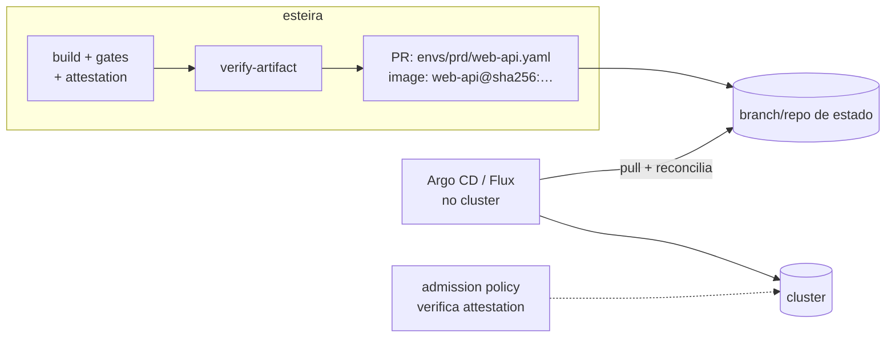

# 04 · Config as code e GitOps

A aplicação descreve a si mesma em arquivos versionados. A plataforma os valida
(`schemas/`) e os lê a cada execução. Nenhuma configuração de esteira mora numa
tela.

## `pipeline.yml`

```yaml
app:
  name: web-api                 # nome da imagem, do Deployment, do serviço

flow:
  model: gitflow                # gitflow | trunk
  integrationBranch: dsv        # só gitflow
  versioning: label             # label | conventional (trunk exige conventional)
  changeRef: "[A-Z][A-Z0-9]+-[0-9]+"   # opcional: PR de release precisa citar um chamado
  environments:
    snapshot: [DSV]             # gitflow: push na integração
    candidate: [HMG]            # PR de release (gitflow) ou merge na main (trunk), em ordem
    release: [PRD]              # depois da promoção

build:
  stack: python                 # node | python | java | container
  python:                       # bloco da stack escolhida (obrigatório)
    version: "3.12"
    workingDirectory: app
    install: ""                 # vazio = requirements*.txt / pyproject.toml
    lint: ruff check .
    test: python -m unittest discover -v
  container:                    # sempre: a imagem é o artefato entregue
    context: app
    dockerfile: app/Dockerfile
    buildArgs:                  # opcional; sem segredo (fica gravado na imagem)
      PYTHON_VERSION: "3.12"

security:
  skipOnSnapshot: []            # sast | sca | iac | container (nunca vale na candidata)
```

| Stack | Bloco | Padrões |
|---|---|---|
| `node` | `version`, `workingDirectory`, `packageManager` (`npm`/`pnpm`/`yarn`), `lint`, `test`, `build` | scripts `lint`/`test`/`build` do `package.json` |
| `python` | `version`, `workingDirectory`, `install`, `lint`, `test` | `pytest` |
| `java` | `version`, `distribution`, `tool` (`maven`/`gradle`), `workingDirectory`, `test` | `mvn verify` / `gradle build` (wrapper se existir) |
| `container` | `test` (opcional) | só a imagem; testes dentro do Dockerfile |

**Teste é obrigatório.** Nos módulos `node` e `python`, se não houver teste para
executar, o build falha (`Nenhum teste: defina ...`). No `java`, o padrão é
`verify`, que roda os testes. Uma esteira que aceita `-DskipTests` mede
cobertura de nada.

## `.github/configs/deploy-config.yml`

```yaml
defaults:                       # vale para todo ambiente
  driver: kubernetes            # kubernetes | gitops-pr | ecs | flyway
  kubernetes:
    cluster: kind               # kind | aks | kubeconfig
  gitops:
    repository: ""              # vazio = este repositório
    branch: environments
    mode: pr                    # pr | commit

accounts:                       # ambiente -> grupo de credenciais
  DSV: NPRD
  PRD: PRD

artifacts:                      # base de cada artefato
  web-api:
    containerPort: 8080
    healthPath: /health
    replicas: 1
    cpu: 256                    # millicores
    memory: 512                 # MiB

envs:
  PRD:
    driver: gitops-pr           # um ambiente pode trocar de driver
    artifacts:
      web-api:
        replicas: 2
```

Valor efetivo: **`defaults` ← `envs.<ENV>`** para driver e acesso, e
**`artifacts.<a>` ← `envs.<ENV>.artifacts.<a>`** para o dimensionamento. Para ver
sem rodar nada:

```bash
scripts/render-deploy-matrix.sh .github/configs/deploy-config.yml DSV,HMG,PRD | jq
```

| Driver | Configuração | Credencial |
|---|---|---|
| `kubernetes` + `kind` | — | nenhuma (efêmero) |
| `kubernetes` + `aks` | `resourceGroup`, `clusterName`, `namespace` | vars `AZURE_TENANT_ID`, `AZURE_CLIENT_ID_<GRUPO>`, `AZURE_SUBSCRIPTION_ID_<GRUPO>` (federada) |
| `kubernetes` + `kubeconfig` | `namespace` | segredo `KUBECONFIG` **do Environment** |
| `gitops-pr` | `repository`, `branch`, `mode`, `path` | `github.token` (mesmo repo) ou segredo `GITOPS_TOKEN` do Environment |
| `ecs` | `ecs.cluster` | vars `AWS_REGION`, `AWS_ROLE_ARN_<GRUPO>` (OIDC) |
| `flyway` | `flyway.database`, `locations`, `schema` | segredos `DB_URL`, `DB_USER`, `DB_PASSWORD` do Environment |

Segredos ficam **no Environment**, nunca no repositório: o job de deploy só os
recebe depois da aprovação daquele ambiente.

## Recursos do `deploy-config.yml`

### Driver por artefato e ordem dentro do ambiente

Um repositório pode entregar artefatos de tecnologias diferentes: a API no
Kubernetes e as migrações do banco pelo Flyway, por exemplo. O driver de cada
item vem do lugar mais específico:

```
artifacts.<a>.driver (com override em envs.<ENV>.artifacts.<a>)  >  envs.<ENV>.driver  >  defaults.driver
```

Cada ambiente é **um job** (uma aprovação) que entrega os seus artefatos em
ordem fixa por driver: **`flyway` primeiro** (o banco sempre antes das
aplicações), depois `ecs`, `kubernetes` e `gitops-pr`. Dentro de um driver,
vale `order` crescente (padrão 100).

Com `gitops-pr`, a migração roda quando o pipeline passa, e a aplicação entra
quando o PR de estado é mergeado. Ou seja, o esquema chega **antes** do código.
Por isso as migrações precisam ser compatíveis com a versão anterior da
aplicação (*expand/contract*: adicionar primeiro, remover só numa release
seguinte).

### Quem aprova, como código

```yaml
envs:
  HMG:
    reviewers:
      - team: minha-org/lideres-tecnicos
  PRD:
    reviewers:
      - team: minha-org/lideres-tecnicos
      - user: gestor-da-aplicacao
    waitTimer: 15                 # minutos de espera depois da aprovação
```

O `scripts/bootstrap-repo.sh` (ou a governança da organização) aplica isso nos
Environments. A regra de quem aprova fica versionada e muda por PR, mas **não é
reaplicada a cada execução**: reconfigurar o repositório dentro do pipeline gera
latência e falhas que nada têm a ver com o código.

### Configuração e segredos de runtime

| O quê | Onde | Vira | Quem vê o valor |
|---|---|---|---|
| configuração (`LOG_LEVEL`, URLs públicas, flags) | `config/<artefato>/<env>.env`, `CHAVE=VALOR` | ConfigMap + `envFrom`, com checksum no pod (mudou a configuração, os pods reiniciam) | todos com acesso ao repositório |
| segredo (senha, token, chave) | **nome** em `artifacts.<a>.secrets: [BANCO, API_KEY]`, **valor** no cofre em `<artefato>/<env>/<NOME>` | ExternalSecret (External Secrets Operator) + `envFrom` | só o cluster |

- o pipeline **nunca toca o valor do segredo**: ele só declara o nome. Isso vale
  igual para os drivers `kubernetes` e `gitops-pr`, e por isso o repositório de
  estado não contém segredo;
- uma chave com cara de segredo (`PASS`, `SECRET`, `TOKEN`, `PRIVATE`,
  `CREDENTIAL`) num arquivo `.env` de configuração **faz o deploy falhar**;
- `secrets` exige `kubernetes.secretStore` (o `ClusterSecretStore` do cluster) no
  ambiente. Sem ele, o deploy recusa em vez de subir a aplicação sem segredo.

### Workers e tempo de rollout

```yaml
artifacts:
  web-api:
    containerPort: 8080
  web-worker:                     # sem containerPort: sem Service, sem probe, sem smoke test
    args: ["python", "worker.py"] # mesma imagem, outro processo
    rolloutTimeout: 300           # segundos (padrão 180)
```

### Banco de dados: driver `flyway`

```yaml
artifacts:
  web-api-db:
    driver: flyway
    order: 10
    flyway:
      database: postgresql
      locations: db/migrations
      schema: public
```

- **Ambiente real**: segredos `DB_URL`, `DB_USER` e `DB_PASSWORD` no Environment.
  O job roda `flyway migrate` e `flyway info`;
- **`flyway.ephemeral: true`** (laboratório, ou num ambiente de verificação):
  sem `DB_URL`, sobe um Postgres descartável e prova que as migrações aplicam do
  zero;
- `destroy` é recusado: apagar dados é operação manual, fora da esteira;
- **migração publicada nunca muda**: o *Resolve* compara com a última release e
  recusa alteração, renomeação ou deleção de arquivo nas pastas de migração. Uma
  correção é sempre uma migração nova. Assim nenhum ambiente diverge e o Flyway
  nunca encontra checksum trocado.

### Contingência

Um ambiente de contingência entra depois de produção na lista de `release`
(`release: [PRD, CTG]`). Os deploys são em série: CTG só recebe a versão depois
que PRD terminou bem.

## GitOps

Pelos [princípios do OpenGitOps](https://opengitops.dev/), o estado desejado
precisa ser **declarativo**, **versionado e imutável**, **puxado** por um agente e
**reconciliado continuamente**.

| Driver | 1 declarativo | 2 versionado | 3 puxado | 4 reconciliado |
|---|---|---|---|---|
| `kubernetes` / `ecs` (push) | ✅ | ✅ (tag + digest) | ❌ | ❌ (drift só aparece no próximo deploy) |
| `gitops-pr` | ✅ | ✅ (o estado guarda o **digest**) | ✅ agente no cluster | ✅ |

Com `gitops-pr`, o pipeline **não tem credencial do cluster**:



- a branch de estado (`environments` por padrão) nasce órfã, só com
  `envs/<env>/<app>.yaml`, e é o que o Argo CD/Flux observa;
- `mode: pr`: o merge do PR, revisado por alguém do cliente, **é** o deploy, e o
  histórico do git é o histórico de produção;
- `mode: commit`: para ambientes não produtivos, sem revisão;
- no cluster, uma política de admissão (Sigstore policy-controller ou Kyverno
  `verifyImages`) pode exigir a mesma attestation. Assim, nem quem tem acesso
  ao repositório de estado consegue colocar uma imagem arbitrária.

No laboratório, PRD usa `gitops-pr` na própria branch `environments` deste
repositório: o PR é aberto e mergeado, mas não há agente aplicando, porque o
cluster `kind` morre com o runner. Para ver a reconciliação de verdade, aponte
um Argo CD para `envs/prd` dessa branch.
