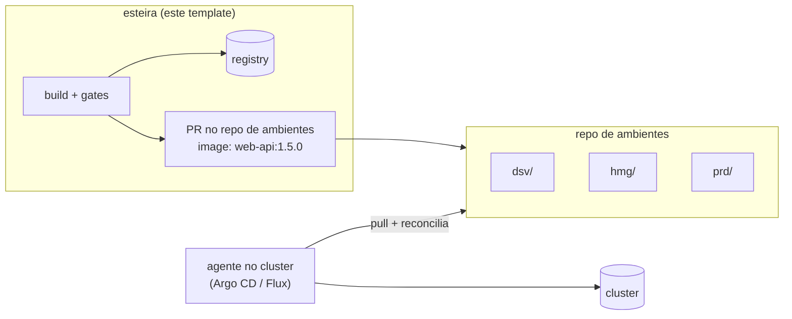

# 04 · Config as code (e onde entra GitOps)

O repositório da aplicação descreve a si mesmo em três arquivos. A plataforma lê
esses arquivos a cada execução. Nada de configuração de esteira fica numa
interface web.

## `pipeline.yml`: como construir

| Campo | Para quê |
|---|---|
| `env.Name` | nome do artefato: imagem, serviço, stack |
| `env.Skip*OnSnapshot` | pula um scanner **só no snapshot**. Na release nada é pulado |
| `build.context` / `build.dockerfile` | onde está o build |
| `build.test` | comando de teste, roda antes do build |
| `deploy.SnapshotBranches` | branches que fazem deploy no push |
| `deploy.SnapshotEnvs` / `StartReleaseEnvs` / `FinishReleaseEnvs` | ambientes de cada momento |

A distribuição de ambientes por momento é uma decisão do time. O padrão é
`DSV` / `HMG` / `PRD`, mas `StartReleaseEnvs: HMG,PRD` também é válido e leva a
RC aos dois ambientes já no PR, com aprovação do Environment em PRD. Nesse caso,
o merge só registra a versão.

## `deploy-config.yml`: onde e como rodar

```yaml
serverType: kind          # driver de deploy
accounts:                 # ambiente -> grupo de contas
  DSV: NPRD
  PRD: PRD
artifacts:                # base, vale para todo ambiente
  web-api:
    containerPort: 8080
    replicas: 1
envs:                     # sobrescritas por ambiente (merge profundo)
  PRD:
    web-api:
      replicas: 2
```

O valor efetivo é `artifacts.<a>` com `envs.<ENV>.<a>` por cima. Para ver o
resultado sem rodar nada:

```bash
scripts/render-deploy-matrix.sh .github/configs/deploy-config.yml DSV,HMG,PRD | jq
```

**O que vai em `envs` e não na base:** tudo o que precisa ser *diferente* entre
ambientes que dividem a mesma conta. O exemplo clássico é a prioridade da regra
no ALB compartilhado: se ficar na base, DSV, TST e HMG tentam a mesma prioridade
e o deploy do segundo falha.

No modelo de referência, este arquivo também carrega: dimensionamento da task
(CPU/memória), health check (caminho, intervalo, carência), regra de roteamento,
**agenda de liga/desliga** (ambientes não produtivos desligam fora do horário
comercial) e revisores do ambiente produtivo.

## `security-config.yml` e `.trivyignore.yaml`: o que bloqueia

Detalhe em [05 · DevSecOps](05-devsecops.md).

## Isso é GitOps?

Pelos [princípios do OpenGitOps](https://opengitops.dev/), um sistema é GitOps
quando o estado desejado é:

| Princípio | Modelo de referência | Este template |
|---|---|---|
| 1. **declarativo** | ✅ YAML de config, IaC | ✅ |
| 2. **versionado e imutável** | ✅ git + tags imutáveis + artefato promovido | ✅ |
| 3. **puxado automaticamente** por um agente | ❌ o pipeline *empurra* (push-based) | ❌ |
| 4. **reconciliado continuamente** | ❌ drift só aparece no próximo deploy | ❌ |

É **config-as-code com CD push-based**, que é o que a maioria das esteiras
corporativas sobre ECS/Lambda pratica. Não é ruim: com IaC por stack e
circuit breaker no serviço, o resultado é previsível. O que falta é detectar
mudança feita fora do git (console, CLI) entre um deploy e outro.

### Evolução para pull-based

Onde o alvo é Kubernetes, o passo natural é separar *construir* de *entregar*:



- o pipeline deixa de ter credencial de deploy. Ele só abre PR num **repositório
  de ambientes** (um diretório ou overlay por ambiente);
- o merge desse PR **é** o deploy, e a aprovação de PRD vira review de PR;
- o agente reconcilia continuamente, e qualquer alteração manual no cluster é
  revertida ou denunciada.

O `pipeline-deploy.yml` deste template é o ponto de troca: um driver `gitops`
substituiria o `kubectl apply` por "atualizar a tag da imagem no repositório de
ambientes e abrir PR".
