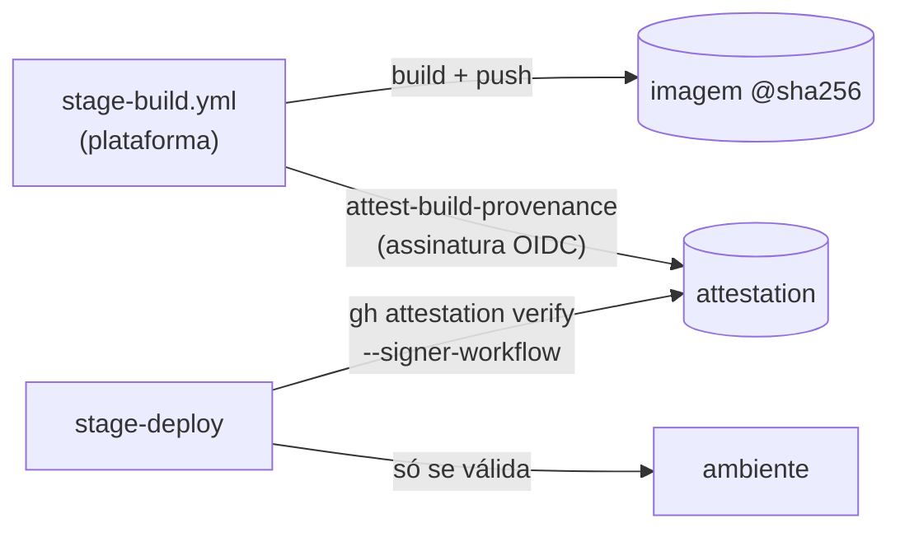

# 05 · DevSecOps

## Gates

| Análise | Ferramenta | snapshot / verify | candidate | Onde configura |
|---|---|---|---|---|
| segredos (histórico inteiro) | gitleaks | ✅ | ✅ | `security-config.yml` → `secrets` |
| SAST | semgrep `p/default`, severidade ERROR | ✅ (pulável) | ✅ | `sast` |
| SCA | trivy fs | ✅ (pulável) | ✅ | `sca.failOn` |
| IaC (Dockerfile, manifestos) | trivy config | ✅ (pulável) | ✅ | `iac.failOn` |
| imagem publicada (por digest) | trivy image | ✅ (pulável) | ✅ | `container.failOn` |
| DAST | ZAP baseline contra o ambiente entregue | DSV | HMG | `dast` |
| testes | módulo da stack | ✅ obrigatório | ✅ obrigatório | `pipeline.yml` → `build.<stack>.test` |

`enabled` liga o scanner; `gate` decide se quebra o build ou só registra. Um
scanner novo entra com `gate: false`. Depois que o ruído é conhecido, o gate
liga.

**O gate certo no lugar certo.** Um scanner que só bloqueia na release ensina o
time a ignorar o aviso durante todo o desenvolvimento, e a release vira a
primeira vez que alguém olha. Aqui o snapshot roda os mesmos gates. O
`skipOnSnapshot` existe para o caso pontual, e nunca vale na candidata.

## Exceções com prazo

```yaml
# .trivyignore.yaml
vulnerabilities:
  - id: CVE-2026-12345
    paths: ["app/requirements.txt"]
    statement: sem correcao publicada; funcao afetada nao e usada. Dono: @time-da-app
    expired_at: 2026-12-31
```

Vencido o prazo, o achado volta a quebrar o build sozinho. Num repositório de
fornecedor, `.trivyignore.yaml` e `security-config.yml` ficam **protegidos por
regra de push**: o fornecedor propõe a exceção por PR, e quem aprova é o
cliente (CODEOWNERS).

## Prova de origem do artefato



- **SBOM e proveniência** (buildx) anexados à imagem;
- **attestation assinada** com a identidade OIDC do workflow de build: prova
  *qual workflow, de qual repositório, em qual commit* produziu aquele digest;
- **todo deploy verifica** antes de aplicar (`verify-artifact`). Uma imagem
  construída na máquina de alguém ou por um workflow do fornecedor tem
  attestation ausente ou de outro signatário, e é recusada;
- **produção recebe o digest**, não a tag. A promoção `RC → X.Y.Z` confere que o
  digest não mudou.

Com a plataforma num repositório separado (o `signer-workflow` fica fora do
alcance do time da aplicação), isso corresponde a **SLSA Build L3**. Em
repositório **privado**, attestations exigem GitHub Enterprise Cloud.

## Cadeia de suprimentos da própria esteira

A esteira é código de terceiros executando com credenciais. Os incidentes de
2025–2026 com actions populares (tags reapontadas para versões com ladrão de
segredos) atingiram quem referenciava **por tag**.

| Medida | Aqui |
|---|---|
| actions de terceiros **por SHA** (com a versão em comentário) | todas |
| imagens de ferramentas **por digest** | gitleaks, semgrep, trivy, zap, actionlint, zizmor |
| versão nova só depois de **quarentena** | Dependabot com `cooldown: 14` dias; pins escolhidos com ≥ 14 dias de publicados |
| sem `secrets: inherit` | nenhum reusable recebe segredos que não usa |
| nada de `${{ }}` dentro de `run:` | tudo por `env:` (evita injeção via nome de branch, título de PR) |
| `persist-credentials: false` | em todo checkout que não faz push |
| permissões mínimas por job | `contents: read` por padrão; escrita só onde precisa |
| `timeout-minutes` em todo job | nenhum job pendurado consumindo runner |
| a esteira se testa | `platform-ci.yml`: actionlint, **zizmor** (análise de segurança de workflows), shellcheck, testes, schema dos exemplos |

Na organização, a [política de Actions](../governance/actions-policy.json)
completa o quadro: só actions da própria organização e de uma lista curta,
**SHA obrigatório**, token padrão só leitura e uma blocklist pronta para
incidentes.

## OIDC preso ao workflow

Confiar no **repositório** (`repo:org/app:*`) deixa qualquer workflow do repo
assumir o papel de deploy, inclusive um que o fornecedor escreva. O
[`governance/oidc/`](../governance/oidc/README.md) inclui `job_workflow_ref` no
token e prende a confiança ao **workflow de deploy da plataforma, numa versão
publicada, no ambiente certo**.

## Responsabilidade sobre os achados

A ferramenta diz *o quê*, não *quem*. Um padrão que funciona é **uma issue viva
por repositório**: checklist de achados reescrito a cada scan, fechado sozinho
quando zera, com o identificador estável do achado como chave. Em DEV, exige-se
que tudo esteja mapeado e priorizado. Em HMG e PRD, gate limpo.
