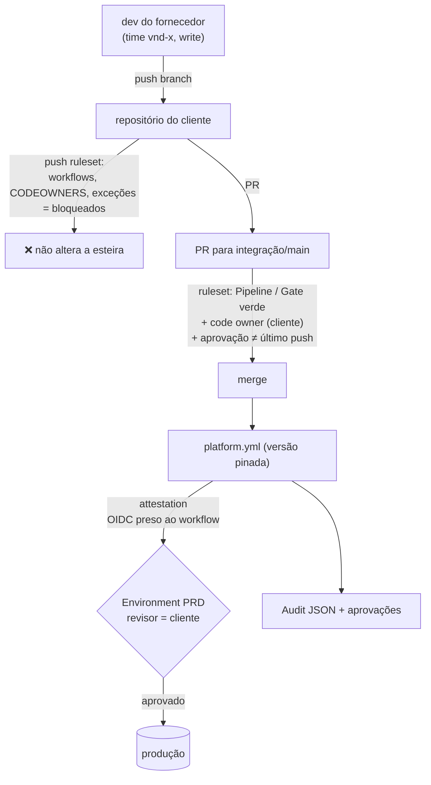

# 08 · Vários fornecedores, um cliente

O cenário: uma organização contrata vários fornecedores para desenvolver nos
repositórios dela. O cliente precisa garantir que:

1. **nada chega à `main` sem passar pela esteira e pela revisão do cliente;**
2. **nada chega à produção sem aprovação do cliente;**
3. **o fornecedor não consegue desligar, contornar ou alterar a esteira;**
4. **tudo deixa evidência**: o quê, quem, quando, aprovado por quem;
5. **entrar e sair um fornecedor é um procedimento**, não uma tarde de cliques.

## Separação de responsabilidades

| Atividade | Fornecedor | Líder técnico do cliente | Plataforma (cliente) | Segurança (cliente) |
|---|---|---|---|---|
| escrever código, testes, `pipeline.yml`, `deploy-config.yml` | **faz** | revisa | — | — |
| aprovar PR para `main`/integração | — | **aprova** (CODEOWNERS) | — | caminhos sensíveis |
| alterar workflows, gates, exceções de segurança | propõe por PR | — | **aprova e aplica** | **aprova exceções** |
| aprovar deploy em HMG/PRD | — | **aprova** (Environment) | — | — |
| criar versão (tag) | — | — | **a esteira cria** (ninguém à mão) | — |
| conceder e revogar acesso | — | solicita | **executa** (`onboard-vendor.sh`) | audita |

A regra que amarra tudo: **quem escreve o código nunca é quem aprova a entrada
na `main` nem a ida para produção**.

## Os controles, camada por camada



| Controle | Garante | Configuração neste repo |
|---|---|---|
| time por fornecedor com **write** (nunca maintain/admin) | fornecedor faz push em branch, não mexe em configurações | `scripts/governance/onboard-vendor.sh` |
| propriedade `fornecedor` no repositório | regras, relatórios e OIDC sabem de quem é o código | `governance/custom-properties.json` |
| **ruleset de branches** da org: PR obrigatório, `Pipeline / Gate`, branch em dia, **code owner**, **aprovação de alguém que não fez o último push**, só merge commit | 1 | `governance/rulesets/branches.json` |
| **ruleset de push** da org: `.github/workflows/**`, `.github/actions/**`, `CODEOWNERS`, `security-config.yml`, `.trivyignore.yaml` bloqueados, com bypass só para a plataforma | 3 | `governance/rulesets/arquivos-plataforma.json` |
| **ruleset de tags**: só a App de release cria; ninguém move ou apaga | versões confiáveis | `governance/rulesets/tags.json` |
| plataforma em repositório próprio, pinada por SHA | 3: a esteira que roda é a que o cliente publicou | [01 · Separando as camadas](01-arquitetura.md#separando-as-camadas) |
| **Environments HMG/PRD** com revisores do cliente e *prevent self-review* | 2 | `envs.<ENV>.reviewers` no `deploy-config.yml`, aplicado pelo bootstrap |
| **release cita o chamado** (`flow.changeRef`) | 4: toda entrega do fornecedor aponta para a demanda que a justifica | `pipeline.yml` |
| **migração publicada imutável** + CODEOWNERS em `db/migrations/` | o dado do cliente não muda sem revisão de quem responde por ele | `check-migrations.sh` |
| **segredo só por nome** (`secrets: [...]`, valor no cofre do cliente) | o fornecedor entrega sem nunca ver credencial de HMG/PRD | `deploy-config.yml` + External Secrets |
| **attestation + verify no deploy** | 3: imagem construída fora da esteira não entra | `stage-build` / `verify-artifact` |
| **OIDC com `job_workflow_ref`** | 3: só o workflow de deploy da plataforma recebe credencial de nuvem | `governance/oidc/` |
| política de Actions: allowlist, SHA obrigatório, token só leitura, forks sem segredo | 3 + supply chain | `governance/actions-policy.json` |
| Audit por execução (inclui aprovações) | 4 | `stage-report.yml` |
| aprovações pendentes em issue | 2, sem entrega perdida | `ops-pending-approvals.yml` |

Aplicar tudo na organização, primeiro em simulação:

```bash
scripts/governance/apply-org.sh <org> <time-plataforma> <id-da-app-de-release>
APLICAR=1 scripts/governance/apply-org.sh <org> <time-plataforma> <id-da-app-de-release>
```

## O que depende do plano do GitHub

O plano decide o que é imposto pela plataforma e o que vira convenção. Situação
pesquisada em outubro de 2026. **Confirme na documentação do GitHub antes de
fechar contrato**, porque esses limites mudam.

| Controle | Free (repo privado) | Team | Enterprise Cloud |
|---|---|---|---|
| rulesets de repositório | — (só público) | ✅ | ✅ |
| **rulesets de organização** (inclui exigir workflows) | — | ✅ (desde 06/2025) | ✅ |
| **regras de push** (bloquear caminhos) | — | ✅ | ✅ (também internal e entre orgs) |
| **revisores obrigatórios em Environment**, timer, bloqueio de bypass de admin | — (só público) | — (só público) | ✅ |
| regra de branch/tag por Environment | — | ✅ | ✅ |
| **artifact attestations** em repo privado | — | — | ✅ |
| merge queue | — | — | ✅ |
| papéis de repositório customizados | — | — | ✅ |
| contas gerenciadas pelo IdP do cliente (EMU) com papel **guest collaborator** | — | — | ✅ (EMU) |
| streaming do audit log (SIEM, bucket) | — | — | ✅ |
| política de Actions com SHA obrigatório | ✅ | ✅ | ✅ (plano não confirmado na documentação) |

**Leitura prática:**

- **Enterprise Cloud** fecha o desenho inteiro dentro do GitHub. Com EMU, a conta
  do fornecedor é emitida e revogada pelo IdP do cliente.
- **Team**: rulesets e regras de push funcionam. Falta o **revisor de
  Environment em repositório privado**, que é justamente o "nada vai para
  produção sem o cliente". As saídas, que podem ser combinadas:
  - produção por **`gitops-pr`**, em que o merge do PR no repositório de estado
    (protegido por ruleset, com code owner do cliente) **é** a aprovação;
  - **OIDC preso ao workflow e ao ambiente**: a credencial de PRD só sai para o
    job de PRD da plataforma, e o gatilho desse job é controlado pelo ruleset;
  - verificação de attestation **no cluster** (policy-controller/Kyverno), em vez
    de no GitHub.
- **Free**: só faz sentido com repositórios públicos. Para código de cliente,
  não serve.

## Modelo de acesso

| Opção | Quando usar | Cuidados |
|---|---|---|
| **membro da org num time `vnd-<fornecedor>`** | padrão | SSO e 2FA obrigatórios; time `closed`; permissão `write` só nos repositórios do contrato |
| **outside collaborator** | acesso pontual a um ou dois repositórios | não entra em times, então a gestão é por repositório; ocupa licença em repo privado |
| **EMU guest collaborator** (Enterprise) | fornecedores com rotatividade alta | conta criada e revogada pelo IdP do cliente; não enxerga repositórios `internal` |

**Branch no repositório do cliente, não fork.** Com fork, os rulesets e os
segredos se comportam diferente, e `pull_request_target` vira tentação, com
um histórico conhecido de vazamentos. Com branch no próprio repositório, as
mesmas regras valem para todo mundo.

## Entrada e saída de fornecedor

**Entrada**

1. `scripts/governance/onboard-vendor.sh <org> <fornecedor> <repos...>` (simula;
   `APLICAR=1` executa): time `vnd-<fornecedor>`, `write` nos repositórios,
   propriedade `fornecedor`;
2. membros entram no time (SSO/2FA da organização);
3. CODEOWNERS de cada repositório: caminhos sensíveis com o time do cliente;
4. Environments HMG/PRD: revisores do cliente, **nunca** o time do fornecedor;
5. o fornecedor recebe este repositório como referência de *como* entregar:
   `pipeline.yml`, fluxo, labels, convenção de commits.

**Saída**

1. `REMOVER=1 APLICAR=1 scripts/governance/onboard-vendor.sh <org> <fornecedor> <repos...>`;
2. revisar *deploy keys*, *webhooks* e tokens criados por membros do fornecedor
   (audit log);
3. segredos que o fornecedor possa ter visto, mesmo em ambiente não produtivo:
   rotacionar.

## Evidência para o cliente

Cada execução deixa um `audit.json` com etapa, versão, commit, autor, resultado
de cada gate e **quem aprovou cada ambiente**. Agregados por propriedade
`fornecedor`, eles respondem às perguntas de gestão sem planilha:

| Pergunta | Fonte |
|---|---|
| quantas entregas cada fornecedor fez em produção, e quanto tempo do PR à produção? | `audit.json` de `promote` + Deployments API |
| quantas falharam nos gates, e em qual? | `audit.json.jobs` |
| quem aprovou cada deploy de produção? | `audit.json.approvals` |
| há exceção de segurança vencendo? | `.trivyignore.yaml` (`expired_at`) |

O histórico de status de deployment na API do GitHub é apagado depois de 90
dias. Para retenção longa, exporte o `audit.json` para um bucket com bloqueio
de escrita (WORM) ou ligue o streaming do audit log (Enterprise).
