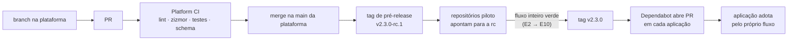

# 10 · Ciclo de vida da plataforma

A esteira é software que roda em **todos** os repositórios ao mesmo tempo. Uma
mudança errada nela não quebra uma aplicação, quebra todas. Por isso ela precisa
do mesmo rigor que exige das aplicações: versão, gates, ambiente de teste,
promoção e rollback.

## Princípios

1. **A plataforma tem versão.** Tags `vX.Y.Z` imutáveis (ruleset de tags +
   *immutable releases*). Nenhuma aplicação consome `@main`.
2. **A aplicação escolhe quando atualizar.** `ci-cd.yml` aponta para a plataforma
   **por SHA**. O Dependabot propõe a versão nova depois da quarentena, e a
   aplicação adota por PR, passando pelos próprios gates.
3. **Rollback da esteira é voltar o SHA.** Uma versão ruim da plataforma nunca
   prende ninguém.
4. **A esteira se testa antes de ser publicada.** O Platform CI roda lint, análise
   de segurança dos workflows, os testes dos scripts, a checagem de permissões
   dos reusables, o YAML das actions e o schema dos exemplos.
5. **O contrato evolui de forma compatível.** Campo novo tem padrão. Campo
   removido continua aceito, e ignorado, por pelo menos uma major. Um rollback de
   aplicação lê o `deploy-config.yml` antigo com a plataforma atual.

## Como uma mudança na plataforma chega às aplicações

| Passo | O que garante |
|---|---|
| Platform CI no PR | a mudança não quebra lint, segurança dos workflows, scripts nem contrato |
| pré-release em repositórios piloto | a mudança funciona de ponta a ponta numa aplicação real, antes de chegar às outras |
| tag final | a versão é imutável; o que foi testado é o que se publica |
| adoção por PR em cada aplicação | cada time vê o diff da esteira e adota no próprio ritmo; um problema atinge só quem adotou |

**Repositórios piloto** são aplicações reais (ou o próprio laboratório) que
aceitam a pré-release. O critério para publicar a versão final é o fluxo
completo verde no piloto: snapshot, DSV, candidata, HMG, promoção e PRD.

## Comparação com o modelo "fork em outra organização"

Um modelo comum é desenvolver a esteira num **fork do repositório central numa
organização de homologação**, testar com forks das aplicações lá e promover por
PR do fork para a `main` do central, que as aplicações consomem diretamente.

| | Fork em org de homologação, consumo em `@main` | Versão, pré-release e pino por SHA |
|---|---|---|
| isolamento do desenvolvimento | ✅ forte (outra organização) | ✅ branch + Platform CI + piloto |
| teste com aplicação real | ✅ fork da aplicação | ✅ piloto na pré-release |
| chegada às aplicações | **imediata e simultânea**, no merge | gradual: cada aplicação adota por PR |
| rollback | revert na `main` (atinge todos de novo) | voltar o SHA (só quem precisa) |
| saber qual versão da esteira gerou um build | difícil (`@main` muda) | o SHA está no workflow e na attestation |
| custo operacional | duas organizações, forks sincronizados | uma organização; tags e um bot |

Os dois modelos podem conviver. O ganho principal vem de **parar de consumir
`@main`**, e isso vale para qualquer um deles.

## O que fica fora deste repositório, de propósito

### Pipeline de infraestrutura (IaC)

Cluster, rede, banco e cofre têm ciclo próprio:
- `plan` no PR;
- `apply` com aprovação;
- dono diferente do dono da aplicação.

O contrato com esta esteira são as **saídas** da infraestrutura, que alimentam o
`deploy-config.yml`: nome do cluster, namespace, `secretStore`, papéis por grupo
de contas. Misturar os dois pipelines faz um deploy de aplicação recriar
infraestrutura.

### Integração com gestão de mudanças

Hoje, `flow.changeRef` exige que o PR de release **cite** um chamado, e a
checagem acontece **antes do merge** (E5), não depois. O passo seguinte é um
script no mesmo ponto (`scripts/check-change.sh`, extensão) que consulta o sistema
de mudanças e exige o chamado em estado aprovado para a janela. Se a mudança só é
recusada depois do merge, a `main` já tem o código e o problema virou incidente.

### Coleta central de evidências

O `audit.json` de cada execução é a unidade de evidência. Numa organização, um
passo no *Report* o envia para um coletor central (bucket imutável, SIEM, data
lake), e as métricas de entrega (DORA) saem de lá, não da interface.
